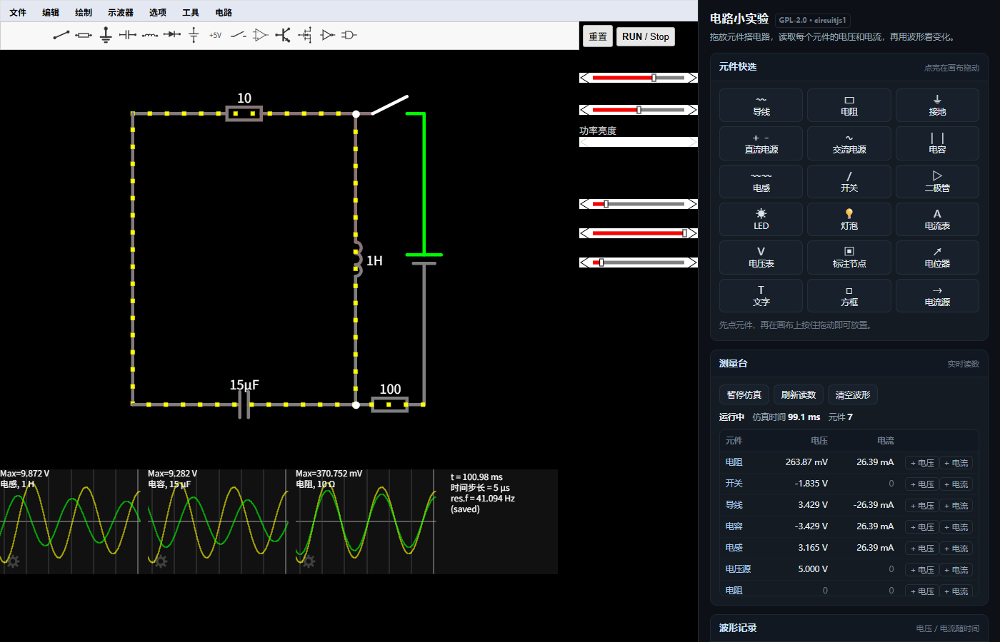

# dsh-circuit · 电路小实验

面向**初中 / 高中物理**的电路模拟器，以 DeepSeek Harness（DSH）插件的形式运行。
左边是可拖放摆放元件的电路画布，右边是中文学习面板：实时读数、多通道波形、挑战任务与自动校验。

仿真内核是开源项目 [CircuitJS1](https://github.com/sharpie7/circuitjs1)（Paul Falstad / Iain Sharp，**GPL-2.0**）。
本插件不重写求解器，只做中文教学外壳 —— 因此面板上的每个数字都来自内核自己算出的结果，
与画布上看到的电压颜色、电流小点完全一致。



## 仓库结构

| 目录 | 内容 |
| --- | --- |
| [`dsh-circuit/`](dsh-circuit) | **插件本体**：路由、静态资源、中文学习面板、测试。安装与使用见 [dsh-circuit/README.md](dsh-circuit/README.md)、[dsh-circuit/INSTALL.md](dsh-circuit/INSTALL.md) |
| [`promo/`](promo) | 宣传片工程：浏览器录制素材、配音与配乐、合成脚本、成片与质检抽帧（`promo/电路小实验 DSH插件 65s.mp4`） |
| [`vendor/`](vendor) | 上游 CircuitJS1 源码与 Web 构建产物（GPL-2.0，未修改） |
| [`dev-tools/`](dev-tools) | 开发期使用的一次性改写脚本、探针与归档（不参与运行） |
| [`docs/`](docs) | 抖音宣传文案、语言包键清单 |
| [`acl-recovery/`](acl-recovery) | 本机沙箱 ACL 排障记录 |

## 插件能力

| 能力 | 说明 |
| --- | --- |
| 摆放元件 | 18 种常用元件一键选中（导线、电阻、接地、直流/交流电源、电容、电感、开关、二极管、LED、灯泡、电流表、电压表、标注节点、电位器……），在画布上按住拖动即可放下 |
| 测量电流 / 电压 | 右侧"测量台"逐行列出每个元件的电压（V）与电流（A），每 0.5 秒刷新，单位在 mA / µA / nA 间自动切换 |
| 看波形 | 给任意元件添加"电压"或"电流"通道（最多 6 条），按**仿真时间**采样并绘制最近 3 秒曲线，自动量程 |
| 做挑战 | 内置 3 个任务（欧姆定律 / 串联分压 / RC 充电），按**真实读数**判定通过，逐条给出"哪里不满足" |

### 安装要点

一行装（GitHub Release 的 tgz 直链，`dsh-plugin` 市场也认这个固定形态）：

```powershell
dsh plugin --profile web add https://github.com/sdaniasdsd/dsh-teaelc/releases/download/v0.1.0/dsh-circuit-0.1.0.tgz
```

开发机自用也可以软链本目录（注意装的是子目录 `dsh-circuit/`，不是仓库根）：

```powershell
dsh plugin --profile web add link:D:\circuit电路模拟\dsh-circuit
```

重启 DSH Web 后访问 `http://127.0.0.1:<端口>/dsh-circuit/`；
自检接口 `/dsh-circuit/api/health` 应返回 `{"ok":true,"engine":"circuitjs1",...}`。
完整步骤（含手动登记、卸载）见 [dsh-circuit/INSTALL.md](dsh-circuit/INSTALL.md)。

| 安装包 | 说明 |
| --- | --- |
| [dsh-circuit-0.1.0.tgz](https://github.com/sdaniasdsd/dsh-teaelc/releases/download/v0.1.0/dsh-circuit-0.1.0.tgz) | 542,690 字节 / 357 个文件；SHA256 `A91F6C8472F2D08A63D9A675776C70481DB40C04C8EFA4BC727D2D5165569421`。自包含，装后 `lib/` 路由、CircuitJS1 内核、330 个示例电路、语言包、`cordis.patch.yml` 与 GPL-2.0 全文齐全 |

## 实现边界（如实说明）

- **没有重写仿真器**：求解、绘图、元件编辑、撤销全部来自上游 CircuitJS1。本插件只提供 HTTP 路由 + 中文教学面板。
- **汉化程度有限**：中文语言包覆盖上游 locale 机制里的 196 条键（顶栏菜单标题、侧栏标签、示波器图例等）。菜单内的元件条目名（`Add Resistor`）由上游字符串固化，仍为英文；面板上的中文名由本插件自行维护。
- **不依赖外网**：内核 JS、330 个示例电路、语言包全部随插件分发，断网可用。
- **挑战判定是规则校验**，不是人工验收：例如"电流在 50 mA ±5% 内"是对内核读数的直接比较，不涉及波形美观或教学效果评价。

## 许可

本仓库以 **GPL-2.0** 分发，因为 `dsh-circuit/assets/app/` 内含 GPL-2.0 作品（CircuitJS1）作为核心。
完整文本见 [dsh-circuit/COPYING.txt](dsh-circuit/COPYING.txt)，上游署名与再发布说明见 [dsh-circuit/NOTICE](dsh-circuit/NOTICE)。
