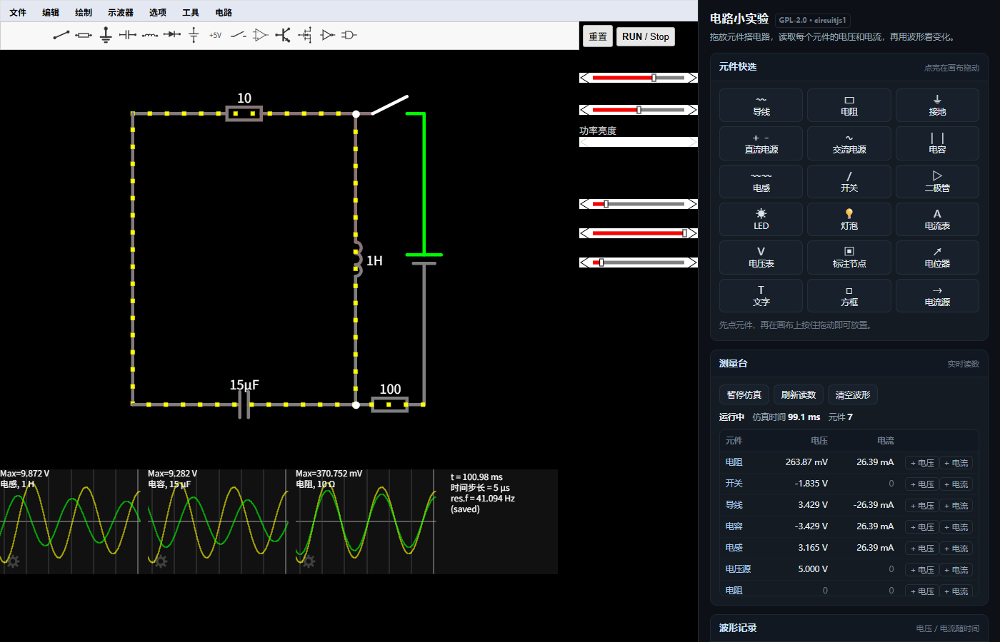

# dsh-circuit · 电路小实验

面向**初中 / 高中物理**的电路模拟器，作为 DeepSeek Harness 插件运行。左边是可拖放摆放元件的电路画布，右边是中文学习面板：实时读数、多通道波形、挑战任务与自动校验。

仿真内核是开源项目 [CircuitJS1](https://github.com/sharpie7/circuitjs1)（Paul Falstad / Iain Sharp，**GPL-2.0**）。本插件不重写求解器，只做中文教学外壳 —— 因此面板上的每个数字都来自内核自己算出的结果，与画布上看到的电压颜色、电流小点完全一致。



## 它能做什么

| 能力 | 说明 |
| --- | --- |
| 摆放元件 | 18 种常用元件一键选中（导线、电阻、接地、直流/交流电源、电容、电感、开关、二极管、LED、灯泡、电流表、电压表、标注节点、电位器……），在画布上按住拖动即可放下 |
| 测量电流 / 电压 | 右侧"测量台"逐行列出每个元件的电压（V）与电流（A），每 0.5 秒刷新，单位为 mA / µA / nA 自动切换 |
| 看波形 | 给任意元件添加"电压"或"电流"通道（最多 6 条），按**仿真时间**采样并绘制最近 3 秒曲线，自动量程 |
| 做挑战 | 内置 3 个任务（欧姆定律 / 串联分压 / RC 充电），按**真实读数**判定通过，逐条给出"哪里不满足" |

## 安装

见 [INSTALL.md](INSTALL.md)。要点：把 `dsh-circuit` 目录以 `link:` 依赖登记进 profile，在 `dsh.profile.bundles` 末尾追加 `dsh-circuit`，重启 DSH Web，然后访问：

```
http://127.0.0.1:<端口>/dsh-circuit/
```

自检：`/dsh-circuit/api/health` 应返回 `{"ok":true,"engine":"circuitjs1",...}`。

## 教学用法

1. **认识欧姆定律**：先放"直流电源"和"电阻"，用导线连成回路，再放"接地"。在测量台里看电阻上的电压和电流，让学生自己算 `U = I·R`，然后改电阻值验证。
2. **串联分压**：两个相同电阻串联，接地点放中间。测量台会显示两者电压相等；把其中一个改大，分压不再相等——这就是分压公式的现场演示。
3. **看瞬态**：电阻 + 电容，给电容加"电压"波形通道，能看到充电曲线从 0 缓慢上升；把电阻或电容改大，曲线明显变慢。

挑战区点任务标题展开，写完电路后点"检查我的电路"。

## 实现边界（如实说明）

- **没有重写仿真器**：求解、绘图、元件编辑、撤销全部是上游 CircuitJS1。本插件只提供 HTTP 路由 + 中文面板。
- **汉化程度有限**：中文语言包覆盖上游 locale 机制里的 196 条键（顶栏菜单标题、侧栏标签、示波器图例等）。菜单里的元件条目名（`Add Resistor`）由上游字符串固化，仍是英文；面板上的中文名由本插件自己维护。
- **不依赖外网**：内核 JS、示例电路（330 个）、语言包全部随插件分发，断网可用。上游的"导出短链接""从 Dropbox 导入"是外网功能，未使用。
- **挑战判定是规则校验**，不是人工验收：例如"电流在 50 mA ±5% 内"是对内核读数的直接比较，不涉及波形美观或教学效果评价。

## 目录结构

```
dsh-circuit/
├─ lib/index.js          # 宿主侧：web 路由 /dsh-circuit/*、静态资源、Host 栅栏
├─ assets/app/
│  ├─ circuitjs.js       # 上游构建产物（GPL-2.0，未修改）
│  ├─ circuitjs.css      # 上游样式（未修改）
│  ├─ circuitjs.html     # 内核挂载页（module 入口）
│  ├─ sim.html           # 外壳页（iframe + 面板）
│  ├─ panel.js           # 中文学习面板（读数 / 波形 / 挑战）
│  ├─ panel.css          # 面板样式
│  ├─ circuits/          # 上游 330 个示例电路
│  ├─ setuplist.txt      # 示例索引
│  └─ locale/            # 上游语言包 + 本插件新增的 locale_zh.txt
├─ cordis.patch.yml      # 挂载声明
├─ COPYING.txt           # GPL-2.0 全文
├─ NOTICE                # 上游署名与再发布说明
└─ docs/                 # 截图、语言包说明
```

## 许可

**GPL-2.0**。插件内含 GPL-2.0 作品（CircuitJS1）作为核心，因此整体同样按 GPL-2.0 分发；完整文本见 [COPYING.txt](COPYING.txt)，上游署名见 [NOTICE](NOTICE)。
